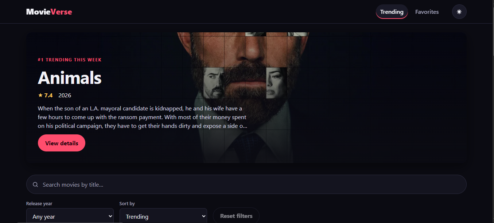
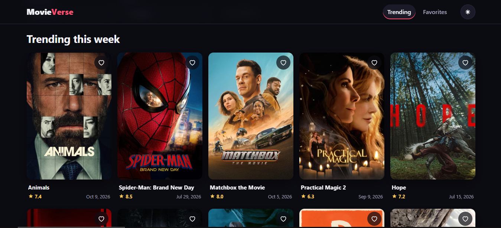
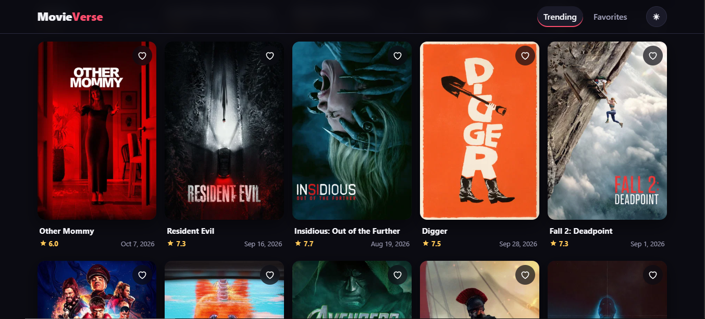

# MovieVerse

A fast, accessible movie-discovery app built with **React 19 + Vite + TypeScript**, powered by the public [TMDB API](https://developer.themoviedb.org/). Browse what's trending, search with debounce, filter by year, sort three ways, read details and keep a persistent list of favorites.

> Frontend only. No backend, no database.
> **Live demo:** <https://film2027.netlify.app/>



## Screenshots

| Trending | Grid |
| --- | --- |
|  |  |

## Features

- **Trending** – weekly trending movies with a hero banner, poster cards (poster, title, rating, release date), skeleton loading, error and empty states, and "Load more" pagination that stops at the last page.
- **Search** – by title, with a 400 ms debounce, no request for blank input, cancellation of outdated requests (`AbortController`) *and* discarding of late responses, so stale results can never replace newer ones.
- **Filter & sort** – release year plus Popularity / Rating / Release date. Without a text query, filtering and sorting happen **on TMDB's side via `/discover/movie`**, so the order is global across the whole catalogue, not just the loaded page.
- **Movie details** – poster, title, tagline, overview, genres, runtime, rating, release date, Add/Remove favorite. Invalid IDs and 404s have dedicated messages; failures can be retried.
- **Trailer, cast & similar movies** – the details page loads trailer, top cast and "More like this" in a **single** request (`append_to_response`, no N+1). The trailer is click-to-load from `youtube-nocookie.com`, and video keys are validated before they reach an iframe URL.
- **Genre filter** – server-side through `/discover/movie?with_genres` when browsing, client-side over the loaded results when searching (hidden gracefully if the genre list cannot load).
- **Keyboard shortcut** – press `/` anywhere to jump to the search box.
- **Favorites** – dedicated page, stored in `localStorage`, deduplicated by TMDB ID, restored on reload, synced between every page (and between browser tabs). Corrupted JSON or unavailable storage never crashes the app.
- **UI** – cinematic dark theme with a light-mode toggle, responsive grid (phones → desktops), keyboard navigation, visible focus rings, skip link, `prefers-reduced-motion` support, semantic HTML and alt text.
- **URL-driven state** – `?q=&year=&sort=` live in the URL, so *Back* from a movie restores your search and views are shareable.

## Tech stack

React 19 · React Router 7 · TypeScript (strict) · Vite 8 · Vitest + React Testing Library + MSW · ESLint (typescript-eslint, react-hooks). No UI or state libraries: plain CSS with CSS variables, React Context + hooks.

## Requirements

- Node.js ≥ 20.19 (developed on Node 22)
- npm
- A free TMDB account and **v3 API key**

## Installation

```bash
git clone <your-repo-url> movieverse
cd movieverse
npm install
cp .env.example .env      # Windows PowerShell: Copy-Item .env.example .env
# edit .env and paste your key
npm run dev               # http://localhost:5173
```

### Environment variables / TMDB API key

1. Create an account at <https://www.themoviedb.org/> and request an API key at <https://www.themoviedb.org/settings/api>.
2. Use the **"API Key" (v3)** value – a 32-character hex string – not the long "Read Access Token".
3. Put it in `.env`:

   ```env
   VITE_TMDB_API_KEY=your_tmdb_v3_api_key_here
   ```

If the key is missing the app shows an explicit message explaining this instead of failing silently.

> **Security note.** Every `VITE_*` variable is embedded in the built JavaScript and is therefore **public** to anyone using the site. `.env` keeps the key out of Git, not out of the browser. Use a key dedicated to this app and never use private tokens. A truly secret key would need a backend/proxy, which is out of scope for this frontend-only exercise. `.env` is git-ignored; only `.env.example` (placeholder) is committed.

## Commands

| Command | What it does |
| --- | --- |
| `npm run dev` | Start the Vite dev server |
| `npm run build` | Type-check (`tsc -b`) and create the production build in `dist/` |
| `npm run preview` | Serve the production build locally |
| `npm run typecheck` | TypeScript strict type-check |
| `npm run lint` | ESLint |
| `npm test` | Run all tests once (Vitest, jsdom, mocked API) |
| `npm run test:watch` | Tests in watch mode |
| `npm run check` | typecheck → lint → test → build (what to run before pushing) |

Tests never contact TMDB: requests are intercepted by [MSW](https://mswjs.io/) using fixtures in `src/test/`.

## Project structure

```
src/
  app/            App.tsx (providers + router), router.tsx (route table)
  components/
    layout/       Header (nav, theme toggle), Footer (TMDB attribution), Layout
    movies/       MovieCard, MovieGrid, Poster (with fallback), Rating, Hero
    search/       SearchBar
    filters/      FilterBar (year + sort)
    favorites/    FavoritesProvider (context + localStorage), FavoriteButton
    feedback/     ErrorState, EmptyState, skeletons
  pages/          TrendingPage, MovieDetailsPage, FavoritesPage, NotFoundPage
  hooks/          useDebounce, useMovieList, useMovieDetails, useFavorites
  services/       tmdb.ts – the only module that talks to the API
  types/          movie.ts – normalised domain types
  utils/          storage.ts, sorting.ts, format.ts
  styles/         tokens.css (design tokens), global.css, components.css
  test/           MSW server, fixtures, test setup and helpers
```

### Data-fetching strategy

| User state | Endpoint | Sorting |
| --- | --- | --- |
| Nothing selected | `/trending/movie/week` | TMDB trending order |
| Year, genre and/or sort chosen, no text | `/discover/movie` (`primary_release_year`, `with_genres`, `sort_by`) | **Server-side, global** |
| Text query | `/search/movie` (`primary_release_year`) | **Client-side, over loaded results only** – `/search` has no sort option |

Details: `/movie/{id}?append_to_response=videos,credits,similar`; genre list: `/genre/movie/list`. Rating sort adds `vote_count.gte=200` so films with a handful of votes don't dominate; release-date sort excludes unreleased titles. Responses are validated/normalised in `services/tmdb.ts` (malformed items are dropped), requests time out after 10 s, HTTP 401/404/429/5xx are mapped to readable messages, and identical GETs are cached for 5 minutes.

## Known limitations

- Sorting and genre-filtering *search results* only apply to the pages loaded so far (documented in the UI) because TMDB's search endpoint can do neither.
- Image base URL (`https://image.tmdb.org/t/p/`) is hard-coded rather than fetched from `/configuration`, saving a request; sizes used (`w342`, `w500`, `w1280`) are documented TMDB sizes.
- The API key is visible in network requests (inherent to a frontend-only app).
- No Playwright E2E suite; behaviour is covered by Vitest integration tests that render the full router.

## Deployment

Deployed on **Netlify**. `netlify.toml` already contains the build command (`npm run build`), the publish directory (`dist`), Node 22, the single-page-app redirect (so `/favorites` and `/movie/:id` survive a refresh) and basic security headers.

1. Netlify → *Add new site* → *Import an existing project* → pick this GitHub repository (private repositories work once the Netlify GitHub app has access to it).
2. Before the first deploy, add the environment variable `VITE_TMDB_API_KEY` (*Site configuration → Environment variables*). It is baked in at build time, so changing it requires a new deploy.
3. Deploy. Every push to `main` redeploys automatically.

## Attribution

This product uses the TMDB API but is not endorsed or certified by TMDB. Movie data and images © TMDB and their respective owners.
